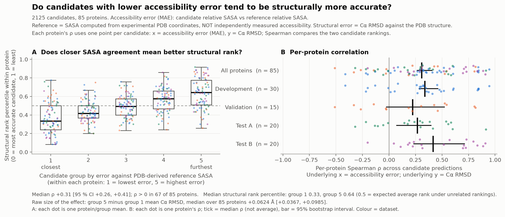
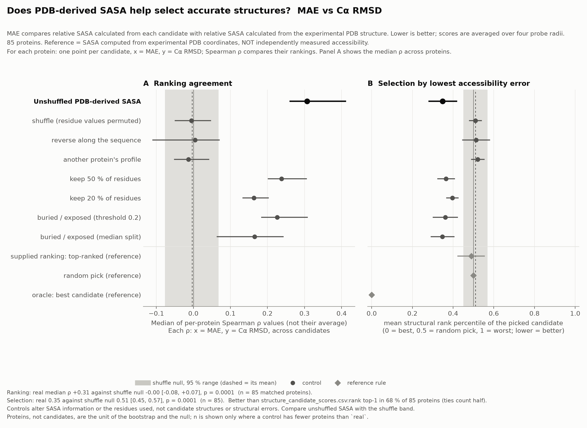
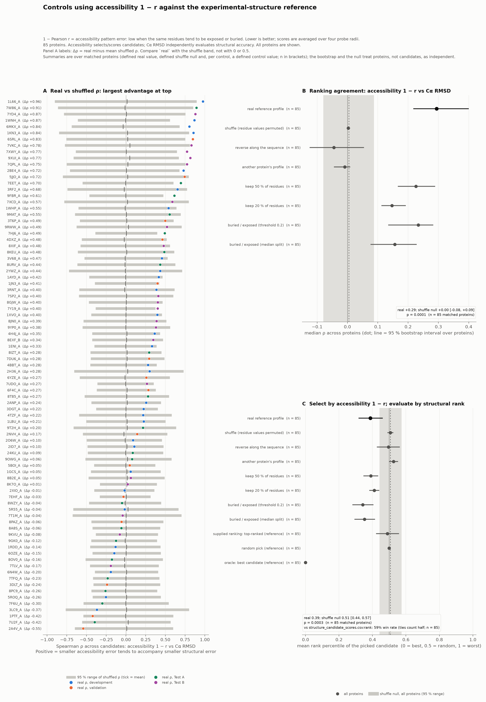

# Stage 3 Figures

**Question:** does lower accessibility error identify structurally better candidates, and is that information lost when residue positions are shuffled?

All figures combine 2,125 candidates from 85 proteins: development (30 proteins, blue), validation (15, orange), Test A (20, green) and Test B (20, purple). Each protein has 25 candidates. No RMSD-range threshold separates the proteins.

| Figure | Question | Headline |
|---|---|---|
| [`fig1_accessibility_vs_accuracy.png`](accessibility_vs_accuracy/fig1_accessibility_vs_accuracy.png) | Do low-MAE candidates rank better structurally? | Group 1 median structural-rank percentile 0.33 vs group 5 0.64; median per-protein rho +0.31 |
| [`controls_mae_rmsd_ca_overview.png`](controls/controls_mae_rmsd_ca_overview.png) | Does the signal survive controls, and does picking the lowest MAE help? | Real rho +0.31; selected percentile 0.35 vs 0.51 under shuffling |
| [`controls_corr_rmsd_ca_overview.png`](controls/controls_corr_rmsd_ca_overview.png) | Same, with `1 - r` as the accessibility error | Real rho +0.29; selected percentile 0.39 vs 0.51 under shuffling |

## Measures

- **Reference accessibility:** relative SASA computed from the experimental PDB coordinates, **not** independently measured accessibility. The plots do not repeat this, so keep it in mind when reading them.
- **Accessibility MAE:** mean absolute difference between candidate and reference relative accessibility, averaged over four probe radii; lower is better. It reflects the actual SASA values, so a constant offset counts as error.
- **Accessibility 1 - r:** one minus the Pearson correlation between candidate and reference residue profiles, averaged over probe radii; lower means closer exposure patterns. It ignores offset and scale, so it can disagree with MAE about which candidate is closer.
- **Structural error:** C-alpha RMSD against the experimental structure, in angstroms; lower is better.
- **Structural rank percentile:** a candidate's rank by RMSD within its own protein, scaled so 0 = best candidate, 0.5 = middle, 1 = worst. It shows ordering, not RMSD differences in angstroms.
- **Ranking agreement:** within each protein, Spearman rho between accessibility error and RMSD across its 25 candidates. Positive rho supports the hypothesis. This is distinct from the residue-profile Pearson correlation used in `1 - r`.
- **Unit of analysis:** the protein. Candidates of one protein share a sequence and a reference, so bootstraps, nulls and medians are taken over proteins, not over the 2,125 candidates.

## Reading the Figures

### Fig 1



- **Panel A:** within each protein, sort the 25 candidates by accessibility error and split them into five groups of five (group 1 = closest to the reference, group 5 = furthest). Each dot is that protein/group's mean structural-rank percentile; the boxes summarise the 85 proteins and the black line is the median. The dashed line at 0.5 is chance (unrelated rankings). Average-rank ties can make group sizes unequal in future datasets.
- **Panel B:** each dot is one protein's Spearman rho, grouped by dataset; each protein appears in the all-protein row and in its dataset row. The tick is the median rho across proteins, not their average; the bar is its 95% bootstrap interval, which describes uncertainty in the median, not the spread of individual proteins.
- **Footer:** median rho +0.31 [95% CI +0.26, +0.41], positive in 67 of 85 proteins. The raw effect is the median, across proteins, of group 5 mean RMSD minus group 1 mean RMSD: +0.0624 angstroms [+0.0367, +0.0985]. It supports the expected direction but is a small typical absolute difference, and it is not a top-1 gain over OpenFold.

### Controls





The MAE figure (first) and the `1 - r` figure (second) have the same rows in two aligned panels, with Spearman rho and selection computed as above.

- **Panel A, ranking agreement:** dots are the median of the per-protein rhos; horizontal lines are 95% bootstrap intervals over proteins. The three reference rows at the bottom are blank here because they do not define an accessibility error across candidates.
- **Panel B, selection:** choose the lowest-accessibility-error candidate for each protein, then average its structural-rank percentile across proteins. Lower is better; 0.5 is a random pick.
- **Grey band:** the 95% shuffle-null range of the aggregate statistic; the dashed line is its mean. It is not a bootstrap interval. Compare unshuffled SASA against this band, not against 0 or 0.5.

| Row | What changes | Why it is included |
|---|---|---|
| Unshuffled PDB-derived SASA | nothing | main condition |
| Shuffled residues | residue values permuted | breaks the residue-to-exposure mapping |
| Reversed sequence | profile reversed along the sequence | breaks positional correspondence but keeps the values |
| Other protein's profile | another protein's profile substituted | tests target specificity |
| Keep 50% / 20% of residues | fewer residues scored | tests sparse coverage |
| Buried / exposed (0.2, median) | profile reduced to two labels | tests whether coarse labels are enough |
| Supplied ranking, random pick, oracle | selection rules, not SASA controls | OpenFold's top-ranked candidate; a random candidate (about 0.5); the lowest actual RMSD, using the known PDB structure (0 by construction) |

The controls change the accessibility information or the residues used, not the candidate structures or their structural errors. All aggregate summaries remain pooled across datasets; colours alone do not establish a separate test-set result.

## Results and Interpretation

| Across all 85 proteins | MAE | 1 - r |
|---|---:|---:|
| Real median rho | +0.31 | +0.29 |
| Shuffle median rho, approximately | 0.00 | 0.00 |
| Real mean selection percentile | 0.35 | 0.39 |
| Shuffle mean selection percentile | 0.51 | 0.51 |
| Win rate versus OpenFold top-ranked, ties count half | 68% | 59% |

Real-versus-shuffle comparisons give p = 0.0001 for ranking agreement with either error, and p = 0.0001 / 0.0003 for MAE / 1 - r selection, as reported by the run. These are aggregate shuffle comparisons, not tests of superiority over OpenFold, and not a test of MAE against `1 - r`; the MAE advantage is descriptive only (+0.02 rho, -0.04 percentile) and would need a paired protein-level comparison. The win rates and the supplied-ranking row are reported in this table, not printed on the plots.

**Answer:** the results support position-specific accessibility as a useful candidate-ranking signal, with exceptions and modest aggregate effects. Shuffled, reversed and wrong-protein profiles fall to about zero; keeping 20-50% of residues or using buried/exposed labels keeps a weaker positive signal.

## Limitations

- Reference accessibility is calculated from the experimental structure: this is a best-case information-content check, not proof that measured accessibility or accessibility-guided diffusion will improve predictions.
- Median rho of about 0.3 means many within-protein orderings still disagree. A mean selected percentile of 0.35 is better than random but far from the oracle's 0.
- The angstrom gain is small (+0.0624 A), and selecting an existing candidate is reranking, not generating better structures.
- Development, validation and test sets are small; do not read dataset-level medians as separate generalisation results.

## Regenerate

From the repository root, install `numpy`, `scipy`, `matplotlib` and the local package (`pip install -e stage3/truth_accessibility`). Source candidate tables are already in `stage3/scoring/results/`; no rescoring is needed for the initial figures.

```bash
python stage3/plots/plot_accessibility_vs_accuracy.py \
  --accessibility-csv \
    stage3/scoring/results/development_validation/candidate_scores.csv \
    stage3/scoring/results/test/candidate_scores.csv \
  --structure-csv \
    stage3/scoring/results/development_validation/candidate_scores.csv \
    stage3/scoring/results/test/candidate_scores.csv \
  --x ac_error --y rmsd_ca --strict --out <figures_out>

python stage3/plots/plot_controls.py \
  --controls-dir <controls_out> --error-metric mae corr \
  --metric rmsd_ca --out <controls_figures_out>
```

Controls plotting reads the locally retained output of [run_controls.py](../controls/README.md), including its shuffle null. Only PNG deliverables and production scripts are stored here; generated SVGs, diagnostic tables, settings, logs and test scripts are omitted. Future datasets should regenerate and replace the figures rather than add duplicate versions.

The deliverables are the three summary PNGs above. Optional `--raw-pages` (accessibility script) and `--per-protein` (controls script) generate detailed inspection plots locally; they are not part of the committed deliverables.
