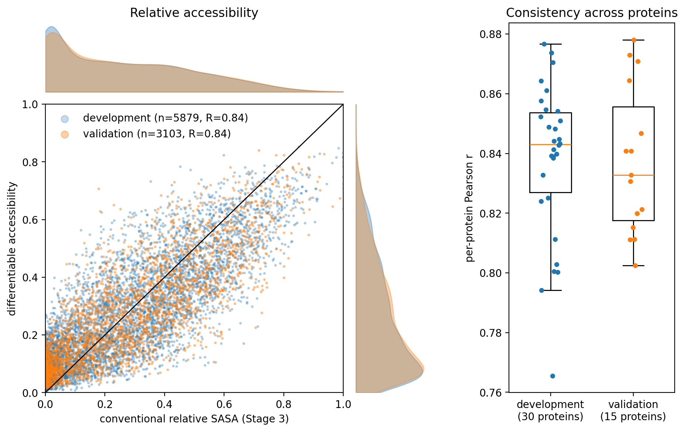
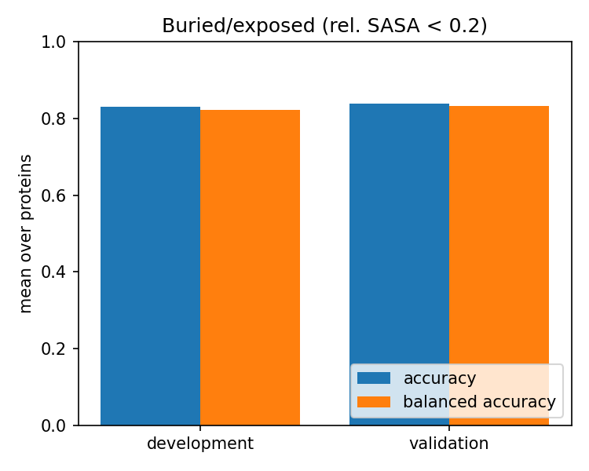
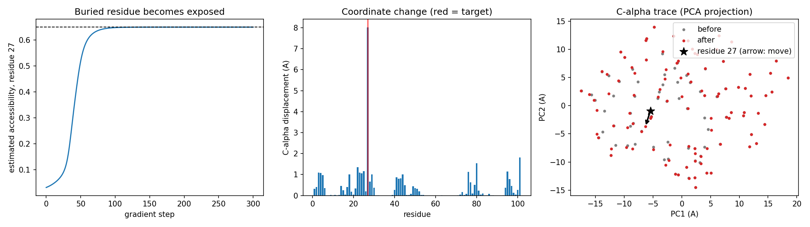

# Stage 5 Figures

**Question:** does a smooth, differentiable estimate built from C-alpha coordinates reproduce conventional SASA, and do its gradients move atoms the right way?

Colours: development proteins (30, used to fit the three model parameters) are blue; validation proteins (15, never used in fitting) are orange. Regenerate with `validate_accessibility.py` (first two figures) and `test_gradients.py` (third).

| Figure | Question | Headline |
|---|---|---|
| `accessibility_comparison.png` | Does the estimate track conventional SASA, and does it generalise? | Pooled Pearson R 0.84 on both splits; per-protein medians about 0.83-0.84 |
| `buried_exposed_accuracy.png` | Can it separate buried from exposed residues? | Accuracy 0.83 (development) and 0.84 (validation) |
| `gradient_test.png` | Do gradients make a buried residue more accessible? | Residue 27 estimate 0.03 to 0.65 |

## Measures

- **Reference accessibility:** conventional relative SASA (calculated by the Stage 2 `accessfold` package) from the Stage 3 truth calculation (probe 1.4 A), clipped to [0, 1]. It comes from the experimental coordinates, not from independently measured accessibility.
- **Differentiable accessibility:** the model output (what the fitted neighbour-density equation calculates), between 0 (buried) and 1 (exposed), computed from C-alpha positions only.
- **Buried / exposed:** buried means relative SASA below 0.2 (the Stage 3 convention); everything else is exposed.
- **Unit of analysis:** scatter and confusion-matrix figures pool all residues of a split; the boxplot gives each protein one value.

## Reading the Figures

### accessibility_comparison.png

- **Scatter (left):** each dot is one residue. Horizontal position is conventional relative SASA (the relative SASA calculated by the Stage 2 `accessfold` package), vertical position is the differentiable estimate (the accessibility calculated by the fitted neighbour-density equation from C-alpha coordinates). Dots on the black diagonal are exact matches. A band that rises along the diagonal means the estimate follows the true exposure pattern. The legend gives each split's residue count and Pearson R.
- **Marginal curves (top and right):** the distribution of true values (top) and estimates (right). Overlapping blue and orange curves mean the two splits have the same exposure mix. The estimate is squeezed toward the middle (few values near 1) compared with the real values, which is why points at high true SASA fall below the diagonal.
- **Boxplot (right):** each dot is one protein's Pearson correlation between estimate and reference; the box shows the middle half, the orange line is the median and the whiskers show the range. Similar boxes for development and validation mean the fit generalises, and a short box means performance is consistent across proteins. Large proteins no longer dominate here.

### buried_exposed_accuracy.png

- **Each matrix:** rows are the conventional label (exposed, buried) and columns are the model's label. Each cell shows a residue count and the percentage of its row. The diagonal cells are correct calls and the off-diagonal cells are errors.
- **Colour:** darker means a larger fraction of that true class, so two dark diagonal cells are the goal.
- **Titles:** accuracy is the fraction of all residues classified correctly. Balanced accuracy averages the two row percentages on the diagonal, so it is not inflated by a larger class.
- **What to take away:** both classes are recovered about 82-85% of the time, and the validation matrix looks like the development one. Errors fall in both directions (roughly 15-18% each), so the model has no strong bias toward calling residues buried or exposed.

### gradient_test.png

- **Left panel:** estimated accessibility of the target residue (27 in 1AYD chain A, the buried residue the model scores lowest) at each gradient-descent step. The dashed line is the target value 0.65. The curve rising to the line shows that the gradient pushes accessibility in the intended direction.
- **Middle panel:** how far each residue's C-alpha moved, in angstroms. The red line marks the target residue; it moves about 8 A while its other residues shift by about 2 A or less, so the optimiser mainly moves the target out of its crowded pocket.
- **Right panel:** the C-alpha trace projected onto its two main axes, grey before and red after. The arrow shows the target residue's move. This is only a 2D projection, so most of the 8 A move is out of the plane and the arrow looks short; the neighbour count (16 within `r0` before, 5 after) printed by `test_gradients.py` and the CSV in `results/gradient_test.csv` give the clearer evidence.
- **Not meant to look realistic:** only C-alpha positions are optimised, with no bond-length or clash terms. The figure shows the gradient works, not that the result is a plausible protein.
